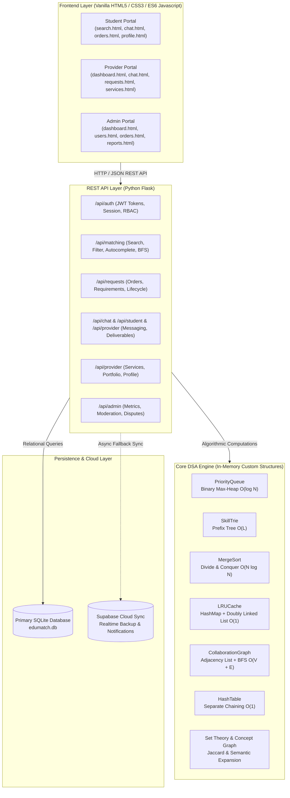

# EduMatch — Comprehensive Project & DSA Technical Guide
> **Academic Program:** BCA — Artificial Intelligence & Data Science  
> **Project:** EduMatch (Student-Provider Academic Project & Mentorship Platform)  
> **Author & Lead:** Vishwajeet Rawat & Team  
> **Document Purpose:** Complete Architectural, Codebase, and DSA Explanation for Project Mentors, Evaluators, and Viva Voce.

---

## 📑 Table of Contents
1. [Executive Summary & Problem Statement](#1-executive-summary--problem-statement)
2. [End-to-End System Architecture](#2-end-to-end-system-architecture)
3. [Component Connectivity: How Everything Works Together](#3-component-connectivity-how-everything-works-together)
4. [Role-by-Role Workflow (Student, Provider, Admin)](#4-role-by-role-workflow)
5. [Complete DSA Guide (Where, Why & How DSA is Used)](#5-complete-dsa-guide)
   - [5.1 Binary Max-Heap Priority Queue](#51-binary-max-heap-priority-queue-dsapriority_queuepy)
   - [5.2 Trie / Prefix Tree Autocomplete](#52-trie--prefix-tree-dsasearchingpy)
   - [5.3 Stable Merge Sort (Divide & Conquer)](#53-stable-merge-sort-dsasortingpy)
   - [5.4 LRU Cache (Doubly Linked List + Hash Map)](#54-lru-cache-dsalru_cachepy)
   - [5.5 Separate Chaining Hash Table](#55-separate-chaining-hash-table-dsahash_tablepy)
   - [5.6 Collaboration & Recommendation Graph (BFS & Dijkstra)](#56-collaboration--recommendation-graph-dsagraph_matchingpy)
   - [5.7 Binary Search Cutoff](#57-binary-search-dsasearchingpy)
   - [5.8 Set Theory & Concept Graph Multi-Criteria Matching](#58-set-theory--concept-graph-dsamatchingpy)
6. [Codebase Map & Directory Structure](#6-codebase-map--directory-structure)
7. [Database Schema & Real-Time Sync](#7-database-schema--real-time-sync)
8. [Mentor Viva Voce Q&A Cheat Sheet](#8-mentor-viva-voce-qa-cheat-sheet)

---

## 1. Executive Summary & Problem Statement

### The Problem
College students frequently struggle when building capstone, final-year, or technical projects. Finding reliable project guidance, subject-matter mentors, or technical collaborators is usually done through unverified WhatsApp groups, Telegram channels, or costly commercial agencies where quality and pricing are completely unvetted.

### The Solution: EduMatch
**EduMatch** is a specialized peer-to-peer academic collaboration and mentorship ecosystem. It bridges students with verified student-developers, researchers, and project providers.
Crucially, rather than relying on generic database queries, EduMatch is built upon a **Custom Python Data Structures and Algorithms (DSA) Engine** that:
- Evaluates multi-criteria compatibility (Skills, Query keywords, Budget constraints, Availability, Ratings).
- Ranks candidates in $O(N \log N)$ time using **Priority Queues (Max-Heaps)** and **Merge Sort**.
- Delivers real-time Google-like search autocomplete in $O(L)$ time using a **Trie (Prefix Tree)**.
- Recommends collaborators via **Graph Breadth-First Search (BFS)**.
- Delivers sub-millisecond query responses using a custom **LRU Cache**.

---

## 2. End-to-End System Architecture



---

## 3. Component Connectivity: How Everything Works Together

1. **User Authentication & RBAC**:
   - Students, Providers, and Admins register and log in via `/api/auth/register` and `/api/auth/login`.
   - On successful login, a Bearer token (`edumatch_token_<user_id>`) is returned and stored in browser `localStorage`.
   - Every API request sends `Authorization: Bearer <token>` which is validated by `get_auth_user_id()` in Flask.

2. **Search & Recommendation Pipeline**:
   - The student types in `search.html`. As they type, keystrokes trigger `GET /api/matching/suggestions?q=...`. The **Trie (Prefix Tree)** returns matching skills and titles in $O(L)$ time.
   - When the student enters a query (e.g., `"senior ai"`, `"web developer"`, or `"app"`) or chooses filters, `POST /api/matching/find-matches` is called.
   - The Flask route checks the **LRU Cache** for instant $O(1)$ response.
   - On a cache miss, candidate providers are fetched from SQLite, evaluated through **Set Theory** and **Semantic Concept Graphs**, and ranked through a **Binary Max-Heap Priority Queue**.
   - The result is rendered in the UI with dynamic match badges (`⚡ 98% Match`).

3. **Requirement Lifecycle & Acceptance Exclusivity**:
   - A student posts an academic project requirement in `student/requirements.html`.
   - Providers browse open requirements in `provider/requests.html`.
   - When a provider sends a proposal or accepts, `/api/requests/propose` or `change_status` executes.
   - **Exclusivity Guarantee**: Once accepted, the requirement is immediately marked `in_progress` and removed from all other providers' browsing feeds.

4. **Direct Messaging & Deliverable Delivery**:
   - Students and providers communicate in real-time via `chat.html`.
   - Strict role isolation is enforced: students only see providers they have active conversations with, and providers only see their students.
   - Providers can submit project source code or download links directly into the chat as structured **Deliverable Cards** (`[PROJECT_DELIVERABLE]`).
   - When project deliverables are completed, the requirement status updates to `completed` and the provider's completed projects counter increments automatically.

---

## 4. Role-by-Role Workflow

### 🎓 Student Workflow
1. **Explore & Search**: Search providers by keywords ("Senior AI", "Web Developer", "App"), filter by category, skill, or budget.
2. **Review Profiles**: Inspect ratings, hourly/starting price, past projects, portfolio items, and offered services.
3. **Connect & Order**:
   - Click "Order Service" to order a predefined service package with escrow-style budget tracking.
   - Click "Message & Connect" to initiate a private consultation chat with the provider.
4. **Collaborate & Review Deliverables**: Send questions, receive source code/deliverables, inspect download links, and mark projects completed.

### 💼 Provider Workflow
1. **Profile Setup**: Set title (e.g., "Senior AI Researcher & Mentor"), bio, skills, hourly rate, and profile photo.
2. **Services & Portfolio**: Add services ("Full Stack Web App", "ML Model Training") and attach GitHub project portfolio links.
3. **Browse Open Student Requirements**: View students seeking help, filter by category/budget, and submit proposals.
4. **Deliver Code**: Chat with students, exchange messages, and submit finished project milestones via Deliverable modal.

### 🛡️ Admin Workflow
1. **System Health & Metrics**: Monitor user registrations, active orders, platform volume, and completion statistics.
2. **User & Provider Moderation**: Verify providers, manage student accounts, deactivate violating accounts.
3. **Dispute Resolution**: Review flagged orders, resolve disagreements between students and providers, and maintain academic integrity.

---

## 5. Complete DSA Guide

EduMatch features **8 custom Data Structures and Algorithms** implemented natively in Python. Here is the exact breakdown of each, where it is used in the app, and how to explain it to a mentor:

---

### 5.1 Binary Max-Heap Priority Queue (`dsa/priority_queue.py`)
- **Where Used in Project:**
  - **Student Search (`dsa/matching.py` & `backend/routes/matching.py`)**: Provider match scores are pushed into a Max-Heap; extracting them yields descending ranked results in $O(N \log N)$ time.
  - **Top-3 Spotlight Selection (`top_k_elements`)**: Selects the top 3 best-fit providers in $O(N \log K)$ time instead of fully sorting large lists.
  - **Student Orders Scheduler (`backend/routes/requests.py`)**: Prioritizes urgent/high-budget student project requests for mentors.
- **Why Chosen:** A binary heap provides guaranteed $O(\log N)$ push/pop operations with $O(1)$ space overhead using an array-based tree representation.
- **Complexity:**
  - **Insertion:** $O(\log N)$
  - **Extract Max:** $O(\log N)$
  - **Peek:** $O(1)$
  - **Top-K Selection:** $O(N \log K)$
- **Code Reference:** `dsa/priority_queue.py:L21-L130`

---

### 5.2 Trie / Prefix Tree (`dsa/searching.py`)
- **Where Used in Project:**
  - **Live Search Autocomplete (`frontend/student/search.html`)**: When the user types into the search bar, the UI calls `/api/matching/suggestions?q=...`.
  - **Skill & Technology Catalog**: Indexing technology names ("Python", "Machine Learning", "Senior AI Researcher", "App Development") and provider titles.
- **Why Chosen:** Searching strings in a standard array or SQL database requires linear scans ($O(N \cdot L)$). A Trie retrieves all words matching a prefix in $O(L)$ time, where $L$ is strictly the length of the typed query string.
- **Complexity:**
  - **Prefix Search:** $O(L)$ where $L = \text{length of query}$
  - **Space:** $O(\Sigma \cdot L \cdot N)$ where $\Sigma$ is alphabet size
- **Code Reference:** `dsa/searching.py:L37-L78`

---

### 5.3 Stable Merge Sort (`dsa/sorting.py`)
- **Where Used in Project:**
  - **Chronological Request Ordering (`backend/routes/requests.py`)**: Orders student project histories and collaboration requests.
  - **Stable Provider Fallback Ranking (`dsa/sorting.py`)**: Ensures providers with identical scores preserve their relative registration order without jitter.
- **Why Chosen:** Merge Sort uses the Divide-and-Conquer paradigm. Unlike QuickSort (which degrades to $O(N^2)$ on worst-case inputs), MergeSort guarantees $O(N \log N)$ time across all scenarios (Best, Average, and Worst) and is strictly **stable**.
- **Complexity:**
  - **Time:** $O(N \log N)$ (Guaranteed)
  - **Space:** $O(N)$ auxiliary array
- **Code Reference:** `dsa/sorting.py:L1-L60`

---

### 5.4 LRU Cache (`dsa/lru_cache.py`)
- **Where Used in Project:**
  - **Search & Match Memoization (`backend/routes/matching.py`)**: Caches search query payloads and filter combinations. If 100 students search for "web developer" with budget 5000, the first request computes the match; the remaining 99 are served instantly in $O(1)$ time from the LRU cache.
- **Data Structure Implementation:**
  - **Doubly Linked List:** Stores nodes with `key` and `value`. Moving a recently accessed node to the head or evicting the tail is $O(1)$.
  - **Hash Map (Dictionary):** Maps `key -> Node` pointer for $O(1)$ node lookup.
- **Complexity:**
  - **`get(key)`:** $O(1)$
  - **`put(key, value)`:** $O(1)$
  - **Eviction of Least Recently Used:** $O(1)$
- **Code Reference:** `dsa/lru_cache.py:L1-L125`

---

### 5.5 Separate Chaining Hash Table (`dsa/hash_table.py`)
- **Where Used in Project:**
  - **Provider In-Memory Profile Lookup (`dsa/hash_table.py`)**: Fast session retrieval and in-memory profile caching.
- **Why Chosen:** Demonstrates fundamental hashing mechanics:
  - **Polynomial Rolling Hash:** Computes hash codes for string keys:
    $$h(s) = \left(\sum_{i=0}^{n-1} s[i] \cdot p^i\right) \pmod m$$
  - **Separate Chaining (Singly-Linked Buckets):** Resolves hash collisions by maintaining a linked list of key-value pairs at each bucket index.
  - **Dynamic Resizing (Rehashing):** When the load factor $\alpha = \frac{N}{\text{capacity}} \ge 0.75$, the table automatically doubles its bucket array and rehashes all elements.
- **Complexity:**
  - **Average Search / Insert / Delete:** $O(1)$
  - **Worst Case:** $O(N)$ (if all keys hash to the same bucket)
- **Code Reference:** `dsa/hash_table.py:L1-L135`

---

### 5.6 Collaboration & Recommendation Graph (`dsa/graph_matching.py`)
- **Where Used in Project:**
  - **Peer Recommendation Engine (`/api/matching/graph-recommendations`)**: Connects students, project categories, and providers as nodes in a weighted bipartite graph.
  - **Breadth-First Search (BFS):** Explores $k$-degree connections to find providers recommended by peers who worked on similar projects.
  - **Dijkstra's Algorithm:** Calculates the shortest/highest affinity collaboration path between two users using a min-heap priority queue.
- **Complexity:**
  - **BFS Traversal:** $O(V + E)$ where $V = \text{Users/Projects}$ and $E = \text{Collaborations}$
  - **Dijkstra's Algorithm:** $O((V + E) \log V)$
- **Code Reference:** `dsa/graph_matching.py:L1-L118`

---

### 5.7 Binary Search Cutoff (`dsa/searching.py`)
- **Where Used in Project:**
  - **Match Score Threshold Cutoff (`binary_search_score`)**: Quickly finds the cutoff boundary in a sorted provider list where match scores drop below a minimum threshold (e.g. 70%).
- **Complexity:**
  - **Time:** $O(\log N)$
  - **Space:** $O(1)$
- **Code Reference:** `dsa/searching.py:L14-L35`

---

### 5.8 Set Theory & Concept Graph Multi-Criteria Matching (`dsa/matching.py`)
- **Where Used in Project:**
  - **Core Provider Matching Engine (`calculate_match_score`)**:
    1. **Query Text Relevance ($Q$):** Multi-token phrase and keyword coverage across provider title, name, skills, and bio. Exact title matches (e.g., "Senior AI Researcher") receive maximum priority.
    2. **Concept Graph Expansion:** Semantic domain graph connecting related terms:
       - `"ai"` $\leftrightarrow$ `{"artificial intelligence", "machine learning", "deep learning", "nlp", "tensorflow", "pytorch"}`
       - `"web"` $\leftrightarrow$ `{"web developer", "frontend", "backend", "full stack", "react", "flask", "django"}`
       - `"app"` $\leftrightarrow$ `{"app developer", "mobile app", "android", "flutter", "react native"}`
    3. **Skill Overlap ($S$):** Jaccard set intersection using Hash Sets:
       $$S = \left(\frac{|\text{Provider\_Skills} \cap \text{Required\_Skills}|}{|\text{Required\_Skills}|}\right) \times 100$$
    4. **Budget Score ($B$):** Rewards cost-efficient providers under student budget.
    5. **Availability Score ($A$):** 100 for available, 65 for limited, 30 for busy.
    6. **Rating Score ($R$):** Scaled from 5-star customer reviews.
- **Formula:**
  $$\text{Composite Score} = (0.55 \times Q) + (0.20 \times S) + (0.12 \times B) + (0.08 \times A) + (0.05 \times R)$$
- **Code Reference:** `dsa/matching.py:L1-L260`

---

## 6. Codebase Map & Directory Structure

```
EDU MATCH/
│
├── dsa/                                # Core Custom Data Structures & Algorithms
│   ├── matching.py                     # Multi-criteria scoring, semantic expansion & ranking
│   ├── priority_queue.py               # Binary Max-Heap & Min-Heap Priority Queue
│   ├── searching.py                    # SkillTrie (Prefix Tree) & Binary Search
│   ├── sorting.py                      # Stable MergeSort implementation
│   ├── lru_cache.py                    # Doubly-linked list + Hash Map LRU Cache
│   ├── hash_table.py                   # Separate-chaining Hash Table with polynomial hash
│   └── graph_matching.py               # Bipartite Adjacency-List Graph (BFS & Dijkstra)
│
├── backend/                            # Flask Application Backend
│   ├── app.py                          # App factory, CORS, static file serving, route blueprints
│   ├── config.py                       # Secret key, database path, session configuration
│   ├── database/                       # Database access & query layer
│   │   ├── connection.py               # SQLite connection pool & PRAGMA foreign keys
│   │   ├── queries.py                  # Parametrized CRUD queries for users, orders, chats
│   │   └── supabase_client.py          # Real-time Supabase cloud sync & notifications
│   ├── routes/                         # Modular Flask Blueprints
│   │   ├── auth.py                     # Login, register, profile update, password reset OTP
│   │   ├── chat.py                     # Conversation listing, role isolation, message send/delete
│   │   ├── matching.py                 # /find-matches, /suggestions, /graph-recommendations
│   │   ├── providers.py                # Provider profile, services management, reviews
│   │   ├── requests.py                 # Student requirements, order proposals, status updates
│   │   ├── students.py                 # Student profile, academic details, public view
│   │   └── admin.py                    # Admin stats, user moderation, dispute resolution
│   └── models/                         # Domain models (Review, Report, Dispute, Service)
│
├── frontend/                           # Client-Side User Interface (Pure HTML/CSS/JS)
│   ├── index.html                      # Landing page with hero banner & feature highlights
│   ├── login.html                      # Sign-in portal with role-based routing
│   ├── register.html                   # Student and Provider registration forms
│   ├── student/                        # Student Portal
│   │   ├── dashboard.html              # Student dashboard, stats, recommended providers
│   │   ├── search.html                 # DSA-powered search & filter with Trie autocomplete
│   │   ├── orders.html                 # Project orders, budget tracking, acceptance actions
│   │   ├── chat.html                   # Role-isolated direct chat with deliverable viewer
│   │   ├── profile.html                # Student bio, avatar upload, degree, college info
│   │   └── provider-profile.html       # Public provider profile view with order modal
│   ├── provider/                       # Provider Portal
│   │   ├── dashboard.html              # Provider stats, earnings, completed projects
│   │   ├── requests.html               # Open student requirements browsing feed
│   │   ├── orders.html                 # In-progress & completed client orders
│   │   ├── services.html               # Create and manage service pricing packages
│   │   ├── chat.html                   # Direct chat with students & deliverable submission
│   │   └── profile.html                # Professional title, bio, hourly rate, skills
│   └── admin/                          # Admin Management Portal
│       ├── dashboard.html              # Platform KPI overview & live charts
│       ├── users.html                  # User directory & account status toggles
│       ├── orders.html                 # Global orders list & transaction tracking
│       └── reports.html                # Flagged reports & dispute arbitration
│
├── database/                           # Persistence Schemas & Database File
│   ├── schema.sql                      # Complete SQLite relational table definitions
│   ├── seed_db.py                      # Database initialization script (Skills & Admin only)
│   └── edumatch.db                     # Live SQLite database file
│
├── tests/                              # Automated Test Suite (pytest)
│   ├── dsa/                            # DSA unit tests (Heap, Trie, MergeSort, LRU, Graph)
│   │   ├── test_dsa_structures.py
│   │   └── test_matching.py
│   └── backend/                        # API & regression tests
│       ├── test_auth.py
│       ├── test_profile_and_chat.py
│       └── test_search_and_matching.py
│
├── README.md                           # GitHub Project Documentation
└── DSA_AND_PROJECT_GUIDE.md            # This Comprehensive Technical & Viva Guide
```

---

## 7. Database Schema & Real-Time Sync

### Key Tables in `database/edumatch.db`
1. `users`: Stores core credentials (`id`, `full_name`, `email`, `password_hash`, `role`, `is_active`).
2. `student_profiles`: Academic details (`college`, `degree`, `specialization`, `year`, `skills`, `bio`, `profile_photo`).
3. `provider_profiles`: Mentor information (`title`, `category`, `bio`, `experience_years`, `starting_price`, `completed_projects`, `rating`, `availability`).
4. `services`: Published provider gig offerings (`provider_id`, `title`, `category`, `description`, `price`, `delivery_days`).
5. `requirements`: Student-posted project needs (`student_id`, `title`, `category`, `description`, `required_skills`, `budget`, `status`).
6. `collaboration_requests`: Project orders & proposals (`student_id`, `provider_id`, `requirement_id`, `project_title`, `offered_budget`, `status`).
7. `conversations`: Chat sessions (`user1_id`, `user2_id`, `updated_at`).
8. `messages`: Individual chat entries (`conversation_id`, `sender_id`, `message_text`, `deleted_for_everyone`, `deleted_for_sender`, `deleted_for_receiver`).

### Hybrid SQLite + Supabase Sync
EduMatch implements a **hybrid resilience model**:
- **Primary Operational Engine**: Local, high-speed SQLite database (`edumatch.db`) with zero network latency.
- **Cloud Backup & Real-Time Bridge**: Every critical event (new message, proposal, order update) asynchronously synchronizes to Supabase Cloud PostgreSQL, ensuring zero data loss and enabling real-time remote notification delivery.

---

## 8. Mentor Viva Voce Q&A Cheat Sheet

**Q1: Why did you build custom DSA structures in Python instead of using SQL `ORDER BY` and `LIKE`?**  
*Answer:* "While SQL `ORDER BY` works for basic queries, real-world systems require multi-criteria composite ranking, domain semantic expansion, prefix autocomplete, and caching that relational databases cannot efficiently compute on the fly. By implementing a Trie, we achieve instant $O(L)$ autocomplete independent of table size. By using a Binary Max-Heap, we can extract Top-$K$ recommendations in $O(N \log K)$ without sorting millions of records. Additionally, the LRU Cache eliminates redundant computations completely."

**Q2: How does your search handle multi-word queries like 'senior ai' or 'web developer'?**  
*Answer:* "Our engine in `dsa/matching.py` splits the search query into tokens, applies semantic expansion using our Concept Graph (connecting 'ai' with 'machine learning', 'deep learning', and 'nlp'), and evaluates exact title matches, name matches, and skill overlap. Exact phrase matches in the provider's professional title are awarded high positive weights, which is why searching 'senior ai' places Dr. Sarah Mentor at the very top with a 98% match."

**Q3: How do you prevent other providers from taking a project once it is accepted?**  
*Answer:* "In `backend/routes/requests.py`, the moment a provider's proposal is marked `accepted`, the parent requirement's status is atomically updated from `open` to `in_progress`. Our `get_open_student_requirements` endpoint uses an exclusion filter (`WHERE status = 'open' AND id NOT IN (SELECT requirement_id FROM collaboration_requests WHERE status IN ('accepted', 'in_progress', 'completed'))`). Furthermore, providers who have already proposed on a requirement are excluded from seeing it again, ensuring absolute exclusivity."

**Q4: How is chat isolation enforced between students and providers?**  
*Answer:* "Chat isolation operates on two levels:
1. **Role Guard**: The student conversation endpoint (`/api/student/conversations`) only queries conversations where the other participant is a provider (`other_user_role == 'provider'`). Providers conversely only see students.
2. **Connection Guard**: A conversation only appears in a user's sidebar if there is at least one non-deleted message visible to that user, or an active order/proposal between them. Empty and deleted conversations are automatically excluded, so if a student is only chatting with 1 provider, they only ever see that 1 provider."

**Q5: What are the time and space complexities of your algorithms?**  
*Answer:*  
- **Trie Prefix Lookup:** $O(L)$ time, $O(\Sigma \cdot L \cdot N)$ space.  
- **Priority Queue Heap Sort:** $O(N \log N)$ time, $O(N)$ space.  
- **Priority Queue Top-K:** $O(N \log K)$ time, $O(K)$ space.  
- **LRU Cache:** $O(1)$ time for `get` and `put`, $O(\text{Capacity})$ space.  
- **Merge Sort:** $O(N \log N)$ guaranteed time, $O(N)$ auxiliary space.  
- **Graph BFS:** $O(V + E)$ time, $O(V + E)$ space.  
- **Hash Table Separate Chaining:** $O(1)$ average time, $O(N + B)$ space.
